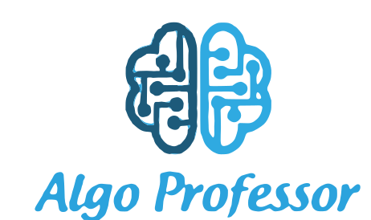
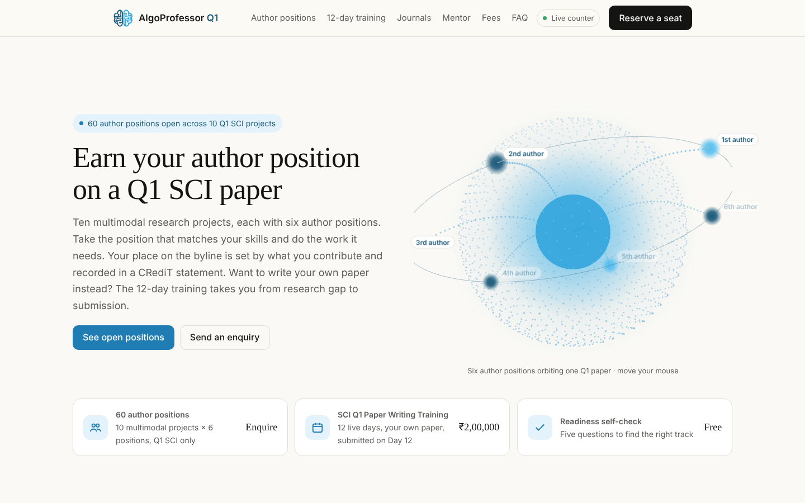
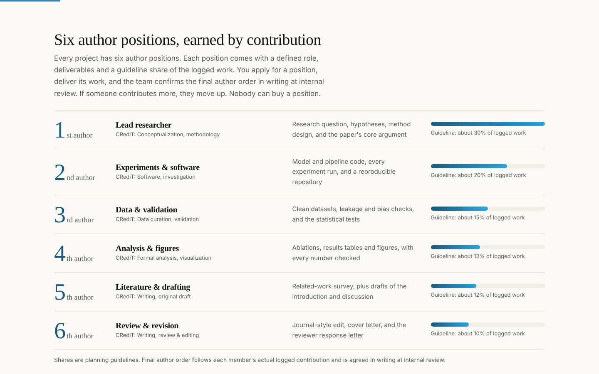
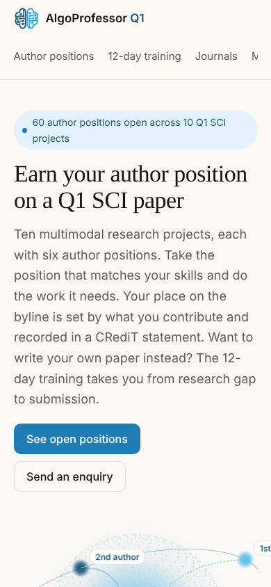

<div align="center">



# AlgoProfessor Q1 Research

**Earn your author position on a Q1 SCI paper.**

Website for the AlgoProfessor SCI Q1 Research Paper Training Program and its multimodal research collaboration projects.

[Live site](https://www.q1.algoprofessor.com) · [AlgoProfessor](https://www.algoprofessor.com) · [Enquire](mailto:ceo@algoprofessor.com)




</div>

---

## Contents

- [About](#about)
- [Features](#features)
- [Screenshots](#screenshots)
- [Tech stack](#tech-stack)
- [Project structure](#project-structure)
- [Deploy on cPanel](#deploy-on-cpanel)
- [Run locally](#run-locally)
- [Editing content](#editing-content)
- [Visitor counter](#visitor-counter)
- [Performance and accessibility](#performance-and-accessibility)
- [Authorship and integrity policy](#authorship-and-integrity-policy)
- [Contact](#contact)

## About

AlgoProfessor AI R&D Solutions (Hyderabad) runs two tracks for researchers who want to publish in Q1 SCI journals:

| Track | What it is | Length |
|---|---|---|
| **SCI Q1 Paper Writing Training** | Live daily sessions. You write one section of your own paper each day, and a mentor reviews it before the next session. You submit on Day 12. | 12 days |
| **Author positions on multimodal research projects** | 10 supervised projects across ten domains, each with six author positions (60 in total). Every paper targets a Q1 SCI journal, and final author order follows logged contribution. | 4–7 months |

The lead mentor is **Dr S Satyanarayana Ph.D., PDF(AI), FARSC**, International Postdoctoral Research Co-Supervisor at NYUST (YunTech) and NKUST, Taiwan.

## Features

**Experience**
- **3D hero globe (Three.js).** About 2,600 points in a Fibonacci sphere with a glowing core. Six author-position nodes orbit it, each with a floating HTML label from "1st author" to "6th author" that tracks the node in 3D. Light arcs flow from each node into the core, and the globe reacts to the mouse.
- **Scroll zoom (GSAP ScrollTrigger).** As you scroll, the camera flies into the globe and the headline recedes. Each section heading zooms into place.
- **Section reveals, 3D card tilt on hover, animated counters** and a reading-progress bar.

**Content**
- **Author position ladder (the centre of the site).** Positions 1st to 6th author, each with its role, CRediT mapping, deliverables, and a guideline share of the logged work (30 / 20 / 15 / 13 / 12 / 10%) shown as animated bars. The page states that final order is agreed in writing at internal review, based on actual contribution.
- **10 projects × 6 open positions.** Each project card shows 1st to 6th position seats, and "Apply for a position" pre-fills the enquiry form with the project and position.
- **Interactive 12-day calendar.** Four phases (Discover, Write the core, Build and prove, Publish). Click a day, or use the arrow keys, to see that day's session and deliverable.
- **Ten domains:** healthcare, agriculture, transportation, affective computing, Industry 4.0, finance, remote sensing, security, education and energy, with a filter by domain.
- **Track record.** Journals participants have published in, and the target publishers.
- **Readiness self-check.** Five checkboxes that recommend a track.
- **Mentor profile, fees, integrity policy and FAQ.**
- **Enquiry form** with the fields from the original enquiry form. It builds a ready-to-send email to `ceo@algoprofessor.com`.

**Engineering**
- One self-contained `index.html`. No build step, no framework, and no external images.
- Light and dark themes via `light-dark()`, following the visitor's system setting.
- A PHP visitor counter with no database.

## Screenshots

| Author positions | Mobile |
|---|---|
|  |  |

## Tech stack

| Layer | Choice |
|---|---|
| Markup and styles | HTML5 and modern CSS (grid, `clamp()`, `color-mix()`, `light-dark()`) |
| 3D | [Three.js](https://threejs.org) 0.160.0 as an ES module via import map (jsDelivr) |
| Scroll animation | [GSAP](https://gsap.com) 3.12.5 + ScrollTrigger (cdnjs) |
| Type | Source Serif 4 (headings) and Inter (text), from Google Fonts |
| Brand | AlgoProfessor logo (inline SVG), colours `#1D5A7A` and `#2BA3DD` |
| Visitor counter | PHP 7.4+ with a JSON file store and file locking |
| Hosting | Any static host. The counter needs PHP (cPanel) |

## Project structure

```
algoprofessor-q1-research/
├── index.html      # The whole site: markup, styles, data arrays, UI script, 3D module
├── counter.php     # Visitor counter endpoint (returns total, today and last 30 days as JSON)
├── assets/
│   └── algoprofessor-logo.svg   # Brand logo (vector), also inlined in index.html
├── docs/           # README screenshots
│   ├── hero-desktop.png
│   ├── positions.png
│   └── hero-mobile.png
├── .gitignore      # Keeps the server-generated visits.json out of git
└── README.md
```

## Deploy on cPanel

1. Open **cPanel → File Manager** and go to the document root for `q1.algoprofessor.com` (usually `public_html/q1` or the subdomain's folder).
2. Upload **`index.html`** and **`counter.php`** into that folder. Overwrite the old `index.html` if there is one.
3. Check that the folder permissions are **755**, so PHP can create `visits.json` next to the counter.
4. Visit the site. The green **visitors** badge in the navigation shows the live count once `counter.php` responds.

**Deploy with Git (optional):** in **cPanel → Git Version Control**, clone this repository into the subdomain's folder, then use **Pull or Deploy** after each push.

## Run locally

```bash
git clone https://github.com/drssnaiml1-cell/algoprofessor-q1-research.git
cd algoprofessor-q1-research

# Site and visitor counter, using PHP's built-in server
php -S localhost:8000
# then open http://localhost:8000
```

Opening `index.html` straight from disk also works. The visitor box then reads "visitor count shows on the live site", because browsers don't run PHP or fetch from `file://`.

## Editing content

All content lives in plain JavaScript arrays near the end of `index.html`. Edit an array and every section that uses it re-renders.

| Array | Controls | Shape |
|---|---|---|
| `D` | The 12 days: session title and deliverable | `[title, deliverable]` |
| `SH` | Short labels on the calendar tiles | `"label"` |
| `PH` | The four phases: name, colours, number of days | `[name, light, dark, days]` |
| `P` | The 10 research projects | `{t: title, f: domain, m: modalities, s: [0,0,0,0,0,0]}` |
| `R` | The six author positions: role names | `[name, CRediT role, description]` |
| `DEL`, `SHARE` | Deliverables and guideline share for positions 1–6 | `"text"`, `number` |
| `J` | Track-record journals | `[journal, publisher]` |
| `INC` | "What the training covers" list | `"module"` |
| `AR` | Research areas, also used in the enquiry form | `"area"` |
| `FAQ` | Questions and answers | `[question, answer]` |

**Marking a position as filled:** in `P`, the array `s` holds one entry per author position. `0` means open and `1` means filled. For example, `s:[1,1,0,0,0,0]` shows the 1st and 2nd author positions as filled.

**Brand and colours:** the site uses the AlgoProfessor logo colours, deep blue `#1D5A7A` and sky blue `#2BA3DD`. The logo is inlined as SVG in the navigation, the mentor section and the footer, and it's also the favicon. The theme is set by CSS variables at the top of the `<style>` block (`--bg`, `--ink`, `--clay` for the accent, `--panel`, `--line`). The 3D colours are the hex values in the module script (`#2ba3dd`, `#a9dcf4`, `0x1d5a7a`).

## Visitor counter

`counter.php` returns JSON:

```json
{ "total": 1284, "today": 37, "month": 612 }
```

- Each browser is counted **once every 30 days**, using a secure, HTTP-only cookie (`ap_v`).
- Daily tallies are kept for 60 days. Dates use Asia/Kolkata time.
- Writes are protected with `flock`, so simultaneous visits don't corrupt the file.
- To reset the count, delete `visits.json` on the server.

## Performance and accessibility

- The 3D canvas renders only while the hero is on screen and pauses in background tabs.
- On phones and low-core devices, the point count and pixel ratio are reduced.
- If a visitor's device has reduced motion turned on, the globe holds still and the scroll zoom, reveals and tilt are switched off.
- If WebGL isn't available, the canvas is removed and the page stays fully usable.
- All text lives in HTML, not in the canvas. The calendar is keyboard-navigable, the form has labelled controls with visible focus, and touch targets are at least 44px.

## Authorship and integrity policy

This policy is part of the product and is stated on the site:

- **Author positions are earned, never sold.** Each position comes with a role and deliverables, and a member who contributes more moves up. Author order is agreed in writing at internal review, based on each member's logged work, and recorded in a CRediT statement.
- **No guaranteed acceptance.** Editors and reviewers decide.
- **Participants write their own papers.** Mentors teach and review.
- **Transparent submission.** Every submission includes a similarity check, an AI-use disclosure and a cover letter, following COPE and ICMJE guidance.

## Contact

**AlgoProfessor AI R&D Solutions**, Hyderabad, India

- Enrolment: [ceo@algoprofessor.com](mailto:ceo@algoprofessor.com)
- General: [contact@algoprofessor.com](mailto:contact@algoprofessor.com)
- Web: [www.algoprofessor.com](https://www.algoprofessor.com)

---

<sub>IEEE, Elsevier, Springer, Wiley, Taylor & Francis, ACM and Nature are trademarks of their respective owners. They are named only as publishing venues, and AlgoProfessor is not affiliated with or endorsed by them.<br>© 2026 AlgoProfessor AI R&D Solutions. All rights reserved.</sub>
